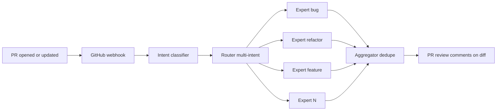
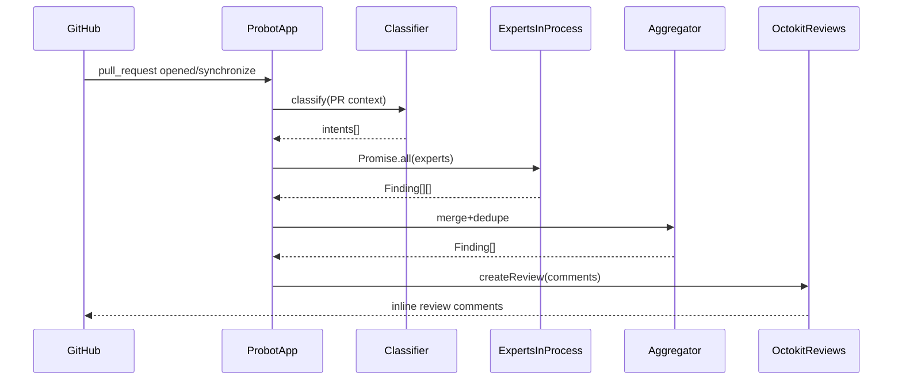

# Solution A — Extension monolithique Probot

PFE013 — Revue de code IA spécialisée sur GitHub  
Document autonome — Architecture et plan d’implémentation

---

## 1. Résumé exécutif et objectifs du mandat

### 1.1 Objectif

Étendre l’application GitHub existante PRIntentLabeler (Probot + TypeScript + PostgreSQL) pour qu’elle ne se limite plus à suggérer des labels d’intention, mais produise une revue de code ancrée sur le diff : commentaires inline localisés (`path` + `line` + `side`), générés par des experts spécialisés sélectionnés selon les intentions détectées.

### 1.2 Positionnement de la Solution A

La Solution A conserve une seule application Node/Probot. Après classification de l’intention, le fan-out vers les experts s’exécute in-process (parallèle via `Promise.allSettled`), suivi d’une agrégation puis de la publication d’une review GitHub via l’API Reviews.

Cette approche privilégie :

- un time-to-demo court ;
- la réutilisation maximale de l’auth, des webhooks, des providers LLM et du file-selector déjà en place ;
- une surface opérationnelle simple pour un PFE (une app, un processus, Postgres déjà présent pour la config).


### 1.3 Modes d’évaluation PFE

Configuration `review.mode` :


| Mode          | Comportement                                                           |
| ------------- | ---------------------------------------------------------------------- |
| `specialized` | Experts métier uniquement (bug, refactor, feature, test, …)            |
| `generalist`  | Un seul expert « large » (baseline de comparaison)                     |
| `both`        | Specialized + generalist sur les mêmes PRs (reviews ou tags distincts) |


Flag d’activation : `ENABLE_SPECIALIZED_REVIEW=true`.

### 1.4 Livrables attendus de cette architecture

1. Commentaires inline sur le diff (Reviews API), pas seulement un commentaire de labels.
2. Routeur multi-intent → plusieurs experts.
3. Protocole comparable specialized vs generalist.
4. Taxonomie étendue avec `resource` et `merge`.
5. Pipeline d’évaluation reproductible (`npm run eval:review`).

---


## 2. Socle existant PRIntentLabeler et écarts


### 2.1 Ce qui existe aujourd’hui

Le dépôt [PRIntentLabeler](https://github.com/MoustaviHaque514/PRIntentLabeler) est une GitHub App mature (~6,5 kLOC TypeScript) qui :

1. reçoit les webhooks `pull_request.*` ;
2. sélectionne des fichiers et construit un contexte token-budgeté ;
3. classifie l’intention via LLM multi-providers (Groq, OpenAI, Anthropic, Gemini, xAI, Perplexity, OpenAI-compatible) ;
4. upsert un commentaire de suggestion de labels (`<!-- llm-pr-labeler -->`) ;
5. optionnellement applique des labels et expose des Check Run actions.

Chemins clés à réutiliser :


| Chemin                       | Rôle                                              |
| ---------------------------- | ------------------------------------------------- |
| `src/handlers/`              | Orchestration webhook                             |
| `src/llm/`                   | Classification, providers, file-selector, budgets |
| `src/github/`                | Lecture PR, commenter, check-run                  |
| `docs/labels-taxonomy-v1.md` | Taxonomie actuelle                                |
| `app.yml`                    | Permissions GitHub App                            |
| `src/utils/constants.ts`     | Seuils, plafonds, budgets                         |


Pipeline actuel (simplifié) :

```
PR webhook → handlers/pull-request-handler
  → github/pr-reader
  → llm/pr-context + file-selector + model-budget
  → llm/provider-factory → classifyPullRequest
  → classification-parser + labels/label-policy
  → comments/build-analysis-comment → github/pr-commenter
```


### 2.2 Écarts par rapport au mandat « revue spécialisée »


| Capacité mandat                     | État actuel                                                            |
| ----------------------------------- | ---------------------------------------------------------------------- |
| Routeur multi-experts               | Absent                                                                 |
| Commentaires inline sur le diff     | Absent (commentaire de labels seulement)                               |
| Protocole specialized vs generalist | Absent                                                                 |
| Intent `resource`                   | Absent                                                                 |
| Intent `merge`                      | Absent (seulement du wording git/merge)                                |
| Alignement `tests` ↔ `test`         | Label `tests` / terme `test` ; normaliser vers `test` pour les experts |


### 2.3 Pipeline cible partagé (conceptuel)




En Solution A, toutes ces étapes (sauf GitHub) vivent dans le même processus Probot, déclenchées synchrone depuis le handler webhook (avec garde-fous anti-timeout).

---


## 3. Architecture runtime


### 3.1 Vision

Une seule app Node/Probot. Après classification, fan-out in-process vers des experts (prompts spécialisés), agrégation, puis publication d’une review GitHub. Le comportement de labeling existant est conservé (ou rendu optionnel) ; la revue spécialisée s’active derrière un flag.

### 3.2 Diagramme de séquence




### 3.3 Principes de conception

1. Réutilisation : même Octokit authentifié Probot, mêmes providers LLM, même file-selector.
2. Isolation logique : dossier `src/experts/` + `src/review/` séparés du labeling, pour une éventuelle migration vers la Solution B plus tard.
3. Contrat Expert stable : interface commune aux deux solutions (portabilité des prompts).
4. Dégradation gracieuse : review partielle + check-run « incomplete » si timeout.
5. Idempotence : marker HTML lié au SHA pour remplacer/dismiss la review précédente.


### 3.4 Limites volontaires (PFE)

- Pas de file d’attente externe (Redis / BullMQ).
- Pas d’extraction du classifieur en library pure (reste couplé au handler).
- Pas de `PlatformAdapter` Gerrit/Chrome dans le MVP (documenté en extension future).

---


## 4. Contrats de données


### 4.1 Intent

```ts
type Intent =
  | "bug" | "feature" | "refactor" | "test"
  | "resource" | "merge" | "documentation"
  | "ci-cd" | "dependencies" | "performance"
  | "security" | "breaking-change";
```

Notes :

- `test` unifie l’ancien label `tests` pour le routage experts.
- `resource` et `merge` sont ajoutés à la taxonomie classifieur + prompts.
- Les intents sans expert MVP dédié (ex. `documentation`, `ci-cd`) peuvent tomber sur le generalist ou être ignorés selon config `expert_enabled[]`.


### 4.2 Finding

```ts
type Finding = {
  expert: Intent | "generalist";
  severity: "blocking" | "major" | "minor" | "nit";
  path: string;
  startLine: number;
  endLine?: number;
  side: "LEFT" | "RIGHT"; // côté du diff pour Reviews API
  title: string;
  body: string;           // markdown du commentaire
  confidence: number;     // 0..1
  category: string;       // ex. regression, missing-test
};
```


### 4.3 Expert

```ts
interface Expert {
  id: Intent | "generalist";
  analyze(ctx: ReviewContext): Promise<Finding[]>;
}
```


### 4.4 ReviewContext

```ts
type ReviewContext = {
  owner: string;
  repo: string;
  pullNumber: number;
  headSha: string;
  baseSha: string;
  intents: Intent[];
  files: Array<{ path: string; patch?: string; content?: string }>;
  prTitle: string;
  prBody: string;
};
```


### 4.5 Agrégateur (règles communes)

1. Déduplication par `(path, startLine, category)`.
2. Fusion multi-experts : conserver la sévérité max ; citer les experts sources dans le body.
3. Plafond : max N commentaires par PR (`max_comments`).
4. Filtre : `confidence >= min_confidence`.
5. Priorisation : `blocking` > `major` > `minor` > `nit`, puis confidence décroissante.


### 4.6 Config runtime (Postgres / env)


| Clé                  | Rôle                            | Exemple                               |
| -------------------- | ------------------------------- | ------------------------------------- |
| `review_mode`        | specialized / generalist / both | `specialized`                         |
| `expert_enabled[]`   | Sous-ensemble d’experts actifs  | `["bug","refactor","feature","test"]` |
| `min_confidence`     | Seuil de publication            | `0.55`                                |
| `max_comments`       | Plafond review                  | `15`                                  |
| `compare_generalist` | Force also-run generalist       | `false`                               |
| `expertMaxTokens`    | Budget tokens par expert        | `4096`                                |
| `max_experts_per_pr` | Top-K intents                   | `3`                                   |


---


## 5. Modules et responsabilités


### 5.1 Nouveau dossier `src/experts/`


| Fichier                 | Responsabilité                                            |
| ----------------------- | --------------------------------------------------------- |
| `types.ts`              | `Expert`, `Finding`, `ReviewContext`, `Intent`            |
| `registry.ts`           | Map `intent → Expert` ; enregistrement lazy               |
| `llm-expert.ts`         | Wrapper : prompt + provider + parse JSON → `Finding[]`    |
| `prompts/bug.md`        | Instructions système expert bug                           |
| `prompts/refactor.md`   | Expert refactor                                           |
| `prompts/feature.md`    | Expert feature                                            |
| `prompts/test.md`       | Expert tests / couverture                                 |
| `prompts/resource.md`   | Expert ressources (fuites, handles, fichiers, connexions) |
| `prompts/merge.md`      | Expert conflits / intégration / ordre de merge            |
| `prompts/generalist.md` | Baseline large (toutes catégories)                        |


MVP experts métier : bug, refactor, feature, test.  
Ensuite : resource, merge.  
Toujours : generalist pour baseline et mode `both`.

### 5.2 Nouveau dossier `src/review/`


| Fichier               | Responsabilité                                                                             |
| --------------------- | ------------------------------------------------------------------------------------------ |
| `router.ts`           | Sélectionne les experts selon `intents` (multi-label → plusieurs experts) ; applique top-K |
| `aggregator.ts`       | Dédup / priorisation / plafond                                                             |
| `line-mapper.ts`      | Mappe positions de patch → `line` + `side` API Reviews (composant critique)            |
| `review-publisher.ts` | Crée / remplace la review Octokit ; marker d’idempotence                                   |
| `run-review.ts`       | Orchestrateur synchrone appelé depuis le handler                                           |


### 5.3 Modifications du code existant

`src/handlers/pull-request-handler.ts`

Après classification labels (comportement actuel conservé ou optionnel) :

```
si ENABLE_SPECIALIZED_REVIEW=true → await runReview(...)
sinon → comportement labeling uniquement
```

Timeout prudent : `Promise.race` entre `runReview` et un timer (ex. 25 s) + plafond d’experts (max 3) pour rester sous les limites webhook GitHub (~10 s soft / 30 s hard selon l’infra).

`src/llm/` (légères)

- Étendre taxonomie + prompts classifieur : `resource`, `merge`.
- Aligner `tests` ↔ `test`.
- Réutiliser budgets tokens existants ; ajouter budget séparé `expertMaxTokens`.
- Réutiliser `provider-factory` depuis `llm-expert.ts`.

`app.yml`

- Passer `pull_requests` de `read` à `write` (reviews + commentaires inline).
- Conserver `checks: write`, `issues: write`, `metadata: read`.


### 5.4 Structure cible (extrait)

```
src/
  experts/
    types.ts
    registry.ts
    llm-expert.ts
    prompts/
      bug.md
      refactor.md
      feature.md
      test.md
      resource.md
      merge.md
      generalist.md
  review/
    router.ts
    aggregator.ts
    line-mapper.ts
    review-publisher.ts
    run-review.ts
  handlers/
    pull-request-handler.ts   # modifié
  llm/                        # taxonomie + budgets étendus
  github/                     # éventuel helper reviews
```

---


## 6. Intégration GitHub


### 6.1 Webhooks

Événements déjà abonnés dans `app.yml` : `pull_request`, `check_run`, `issue_comment`, `installation`.

Pour la revue spécialisée, les actions pertinentes restent :

- `opened`, `reopened`, `synchronize` (nouveau SHA → nouvelle review) ;
- éventuellement `ready_for_review` si on ignore les drafts.

Le handler actuel traite déjà ces événements ; on y branche `runReview`.

### 6.2 Permissions


| Permission      | Actuel  | Requis Solution A                                |
| --------------- | ------- | ------------------------------------------------ |
| `pull_requests` | `read`  | `write`                                          |
| `checks`        | `write` | `write` (statut review incomplete / done)        |
| `issues`        | `write` | `write` (commentaire labels legacy)              |
| `metadata`      | `read`  | `read`                                           |
| `contents`      | non     | optionnel `read` si on charge le blob hors patch |


Action manuelle post-changement `app.yml` : mettre à jour l’App sur github.com/settings/apps (le manifeste ne synchronise pas automatiquement).

### 6.3 Reviews API

Endpoint :

```
POST /repos/{owner}/{repo}/pulls/{pull_number}/reviews
```

Corps typique :

```json
{
  "commit_id": "<headSha>",
  "event": "COMMENT",
  "body": "<!-- llm-specialized-review:<sha> -->\nRevue IA spécialisée…",
  "comments": [
    {
      "path": "src/foo.ts",
      "line": 42,
      "side": "RIGHT",
      "body": "**[bug / major]** Titre\n\nDétail…"
    }
  ]
}
```

- `event: COMMENT` par défaut (non bloquant).
- `event: REQUEST_CHANGES` si politique stricte (opt-in config, recommandé désactivé en MVP PFE).


### 6.4 Idempotence

1. Marker HTML dans le body de la review : `<!-- llm-specialized-review:{sha} -->`.
2. Avant de poster : lister les reviews de l’app pour ce PR ; si une review existe pour le même SHA → skip ; si SHA différent → dismiss / remplacer (nouvelle review).
3. Sur `synchronize` (nouveau SHA) : toujours une revue fraîche pour le nouveau head.


### 6.5 Format du commentaire inline

```markdown
**[bug · major · conf 0.82]** Possible regression null

Le chemin `user?.id` n’est plus vérifié après le refactor.
Risque : NPE si `user` est absent.

Experts: bug
Category: regression
```


### 6.6 Check Run (optionnel mais utile)

Réutiliser `src/github/check-run.ts` pour signaler :

- `Review running` (début) ;
- `Review complete (N findings)` ;
- `Review incomplete (timeout / partial)`.

---


## 7. Routage multi-intent et prompts experts


### 7.1 Router

Entrée : `intents[]` triés par score de classification.  
Sortie : liste d’experts à invoquer.

Règles :

1. Filtrer selon `expert_enabled[]`.
2. Prendre top-K (`max_experts_per_pr`, défaut 3).
3. Si `review_mode === "generalist"` → uniquement generalist.
4. Si `review_mode === "specialized"` → experts métier seulement.
5. Si `review_mode === "both"` → experts métier + generalist (reviews séparées ou tags `expert:` distincts).
6. Si aucun intent n’a d’expert → fallback generalist (config `fallback_generalist=true`).


### 7.2 Construction du prompt expert (`llm-expert.ts`)

Le prompt combiné contient :

1. Instructions système (fichier `prompts/{id}.md`).
2. Métadonnées PR (titre, body tronqué, intents).
3. Hunks de diff sélectionnés (file-selector + budget `expertMaxTokens`).
4. Contraintes de sortie JSON strictes alignées sur `Finding`.
5. Contraintes de localisation : `path` doit être un fichier du contexte ; `startLine` doit tomber dans un hunk ; `side` RIGHT par défaut pour le code ajouté.

Exemple de schéma JSON attendu :

```json
{
  "findings": [
    {
      "severity": "major",
      "path": "src/x.ts",
      "startLine": 10,
      "side": "RIGHT",
      "title": "...",
      "body": "...",
      "confidence": 0.8,
      "category": "regression"
    }
  ]
}
```

Le wrapper ajoute `expert: id` après parsing.

### 7.3 Spécialisation des prompts (intentions)


| Expert     | Focus typique                                                         |
| ---------- | --------------------------------------------------------------------- |
| bug        | Régressions, null-safety, conditions manquantes, gestion d’erreurs    |
| refactor   | Comportement préservé ?, smelly extractions, API breakage silencieuse |
| feature    | Completeness, edge cases, validation d’entrées, docs API              |
| test       | Couverture des chemins critiques, asserts faibles, tests flaky        |
| resource   | Fuites (fd, connexions, listeners), cleanup `finally`, timeouts       |
| merge      | Ordre d’intégration, conflits sémantiques, feature flags              |
| generalist | Checklist large (qualité, sécu légère, style) — baseline              |


### 7.4 Fan-out in-process

```ts
const results = await Promise.allSettled(
  experts.map((e) => withTimeout(e.analyze(ctx), EXPERT_TIMEOUT_MS))
);
// collecter Finding[] des fulfilled ; logger les rejected
```

---


## 8. Plan d’implémentation par phases


### Phase 1 — Fondations

Objectif : contrats + mapping de lignes + publisher dry-run.

- Types `Expert` / `Finding` / `ReviewContext`.
- `line-mapper.ts` + tests unitaires sur patches réels (fixtures).
- Permission Reviews (`app.yml` + App settings).
- `review-publisher.ts` en mode no-op / dry-run (log JSON).

Done when : tests line-mapper verts ; dry-run imprime des comments API-valides sur un fixture PR.

### Phase 2 — Expert generalist bout-en-bout

Objectif : prouver le pipeline complet avec un seul prompt large.

- `prompts/generalist.md` + `llm-expert.ts`.
- `run-review.ts` minimal (pas de router multi).
- Branchement flag dans le handler.
- Publication réelle sur repo de démo.

Done when : une PR de démo reçoit des commentaires inline du generalist.

### Phase 3 — Classifieur étendu

Objectif : taxonomie prête pour le routage.

- Ajouter `resource`, `merge` aux prompts classifieur + docs taxonomie.
- Normaliser `tests` → `test`.
- Tests de parsing multi-intent.

Done when : fixtures multi-label passent ; nouveaux intents apparaissent dans les commentaires de labels.

### Phase 4 — Experts spécialisés MVP

Objectif : bug, refactor, feature, test + router + aggregator.

- Quatre prompts + registry.
- `router.ts` + `aggregator.ts`.
- Top-K + `allSettled` + timeouts.

Done when : PR « bug » déclenche surtout l’expert bug ; agrégateur déduplique correctement en tests.

### Phase 5 — Mode both

Objectif : comparaison specialized vs generalist.

- Reviews séparées (markers distincts) ou tags dans le body.
- Config `compare_generalist`.

Done when : sur une même PR, les deux modes sont visibles et différenciables.

### Phase 6 — Évaluation

Objectif : métriques pour le rapport PFE.

- Dataset de PRs publiques / annotées.
- Script `npm run eval:review`.
- Métriques : précision commentaire, rappel des défauts connus, exactitude path/line ±1.

Done when : tableau de résultats reproductible documenté dans le README.

### Phase 7 — Docs + démo

- Section README « Specialized review ».
- Dépôt public reproductible + guide install.
- Capture d’écran / vidéo d’une review inline.

Done when : un tiers peut installer l’app et reproduire une revue sur le repo démo.

### 8.1 Stratégie anti-timeout (spécifique A)


| Mesure             | Détail                                                      |
| ------------------ | ----------------------------------------------------------- |
| Parallélisme       | `Promise.allSettled`, jamais séquentiel                     |
| Top-K intents      | max 3 par défaut                                            |
| Contexte tronqué   | file-selector existant                                      |
| Timeout global     | `Promise.race` sur `runReview`                              |
| Timeout par expert | ex. 8–12 s                                                  |
| Dégradation        | review partielle + check-run « incomplete »                 |
| Cache              | clé `(sha, expertId)` pour éviter re-appels LLM sur retries |


---


## 9. Tests, dataset et protocole specialized vs generalist


### 9.1 Tests unitaires


| Cible                | Cas                                                            |
| -------------------- | -------------------------------------------------------------- |
| `aggregator`         | dédup, fusion sévérité, plafond, filtre confidence             |
| `line-mapper`        | patches multi-hunk, side LEFT/RIGHT, lignes hors hunk rejetées |
| Parser JSON findings | JSON valide, JSON bruité, champs manquants                     |
| `router`             | top-K, modes, fallback generalist                              |


### 9.2 Tests d’intégration

- Handler avec Octokit mocké + provider LLM mocké.
- Vérifier qu’un `synchronize` avec flag ON appelle `createReview` avec le bon `commit_id`.
- Vérifier qu’un échec d’un expert n’empêche pas la publication des autres.


### 9.3 E2E manuel

App installée sur repo de démo ; une PR par intention (bug, feature, refactor, test) ; vérifier localisation et pertinence.

### 9.4 Dataset d’évaluation

Format JSONL suggéré :

```json
{
  "repo": "owner/name",
  "pr": 123,
  "sha": "abc…",
  "gold_findings": [
    {
      "path": "src/a.ts",
      "startLine": 40,
      "category": "regression",
      "severity": "major"
    }
  ]
}
```


### 9.5 Métriques


| Métrique               | Définition                        |
| ---------------------- | --------------------------------- |
| Précision @commentaire | findings publiés ∩ gold / publiés |
| Rappel                 | gold trouvés / gold               |
| Localisation exacte    | même path + même ligne            |
| Localisation ±1        | même path, |Δline| ≤ 1            |
| Redondance             | doublons post-agrégateur / total  |
| Latence                | p50 / p95 de `runReview`          |


### 9.6 Protocole specialized vs generalist

1. Même dataset, mêmes SHA, mêmes budgets tokens globaux.
2. Run A : `review_mode=specialized`.
3. Run B : `review_mode=generalist`.
4. Comparer précision, rappel, localisation, redondance, latence.
5. Mode `both` uniquement pour inspection qualitative (pas mélanger les scores).

Script : `npm run eval:review -- --mode specialized|generalist`.

---


## 10. Avantages, inconvénients et risques


### 10.1 Avantages

- Time-to-demo court : peu de nouvelles infra.
- Une seule app à déployer et monitorer.
- Réutilise auth Probot, webhooks, LLM multi-providers, file-selector, Postgres config.
- Ops PFE simples : docker-compose actuel suffit.
- Contrat Expert isolé : migration progressive vers B possible sans réécrire les prompts.


### 10.2 Inconvénients

- Webhook synchrone fragile sous charge multi-experts (latence LLM).
- Couplage fort handler ↔ engine ↔ GitHub.
- Multi-plateforme (Gerrit, extension Chrome) plus coûteux à greffer.
- A/B et éval moins propres qu’un engine découplé (harness à brancher dans le même process).
- Scalabilité horizontale limitée (scale = scale de l’app Probot entière).


### 10.3 Risques et mitigations


| Risque                            | Impact                               | Mitigation                                               |
| --------------------------------- | ------------------------------------ | -------------------------------------------------------- |
| Timeouts GitHub                   | Reviews manquantes                   | Top-K, parallélisme, review partielle, check-run         |
| Faux positifs de ligne            | Commentaires mal ancrés / API reject | `line-mapper` testé + confidence + validation hunk       |
| Coût LLM                          | Budget PFE dépassé                   | Budgets tokens, cache `(sha, expertId)`, max experts     |
| Faux positifs sémantiques         | Bruit sur les PRs                    | Seuils severity/confidence, plafond N, mode suggest-only |
| Permissions App non mises à jour  | 403 sur Reviews API                  | Checklist phase 1 + test dry-run réel                    |
| Drift taxonomie labels vs intents | Mauvais routage                      | Table de normalisation unique `tests`→`test`             |


---


## 11. Extensions futures (profondeur limitée en A)


### 11.1 Vers Solution B (chemin naturel)

1. Extraire `run-review.ts` + experts vers `src/engine/`.
2. Introduire table `review_jobs` et enqueue depuis le webhook.
3. Worker async + poster séparé.

Le contrat `Expert` / `Finding` est conçu pour ne pas changer.

### 11.2 Gerrit / extension Chrome

Hors MVP A. Nécessiterait un `PlatformAdapter` (`fetchPR`, `postReview`) — mieux adressé par la Solution B. En A, on documente seulement l’interface cible sans l’implémenter.

### 11.3 Politique REQUEST_CHANGES

Opt-in pour orgs strictes ; non recommandé par défaut (bruit + friction développeur).

### 11.4 Cache et observabilité

- Cache LLM mémoire ou table Postgres `expert_cache(sha, expert_id, findings jsonb)`.
- Logs structurés : `installation_id`, `pr`, `sha`, `experts`, `latency_ms`, `findings_kept`.

---

